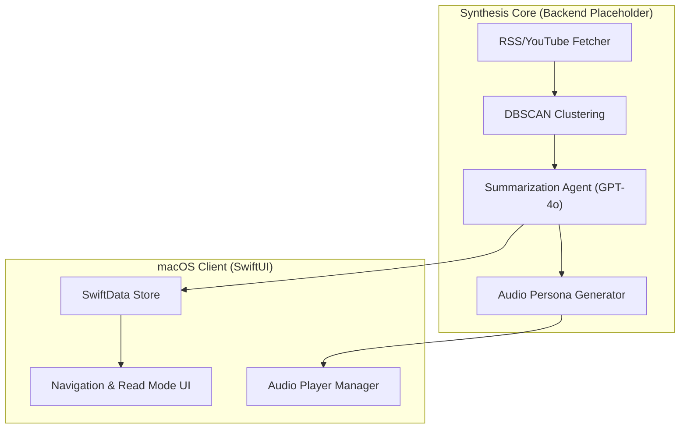

# Architecture Documentation: Briefly macOS

Briefly is designed as a **Synthesis-First** news application. Unlike traditional aggregators that surface a list of links, Briefly uses a multi-stage pipeline to cluster related information and transform it into a high-level briefing.

## 1. System Overview

Briefly follows a hybrid architecture, balancing native performance with powerful cloud-based processing.

## 2. Component Layers

### 2.1 File Organization & Structure

The codebase is organized into functional layers to improve maintainability and scalability:

- **App/**: Contains the main `@main` entry point of the application.
- **Models/**: All SwiftData `@Model` definitions (e.g., `DataModel.swift`).
- **Views/**: SwiftUI components and page layouts (e.g., `ContentView.swift`, `DiscoverFeedsView.swift`).
- **Engines/**: Business logic, networking, and data processing (e.g., `NewsEngine.swift`, `RSSParser.swift`).
- **Resources/**: Application assets, entitlements, and configuration files.

### 2.2 Frontend (SwiftUI)

### 2.2 Data Model

The data architecture is centered around the concept of a `Story` (a cluster of articles) rather than individual items.

- `Category`: Logical groupings for user navigation.
- `Source`: Individual ingest points (RSS, YouTube URLs, Newsletters).
- `Article`: Raw data points from sources.
- `Story`: The synthesized output containing the summary, hook, facts, and context.

### 2.3 Synthesis Engine (`NewsEngine`)

Currently implemented as a foundational layer in the macOS app, the engine is responsible for:

- Orchestrating data flow.
- (Planned) Communicating with a Python/FastAPI backend for computationally expensive tasks like:
  - Semantic clustering of articles using vector embeddings.
  - LLM-based summarization and script generation.

### 2.4 Audio Pipeline (Planned)

To enable "Listen Mode," the app will utilize a procedural podcasting pipeline:

- **Scripting**: Converting text summaries into natural Q&A banter between two AI hosts.
- **Synthesis**: Leveraging ElevenLabs or Cartesia for high-fidelity, low-latency audio.
- **Playback**: Integrated with macOS system media controls.

## 3. Data Flow

1. **Ingestion**: The `NewsEngine` pulls raw data from Sources (RSS/YouTube/Email).
2. **Processing**: Articles are clustered by narrative similarity.
3. **Synthesis**: The LLM generates a "Smart Brevity" summary and a podcast script.
4. **Delivery**: The macOS app fetches the synthesis, updates the local SwiftData store, and notifies the user.
5. **Consumption**: The user reads the summary in the detail view or listens to the audio briefing.
